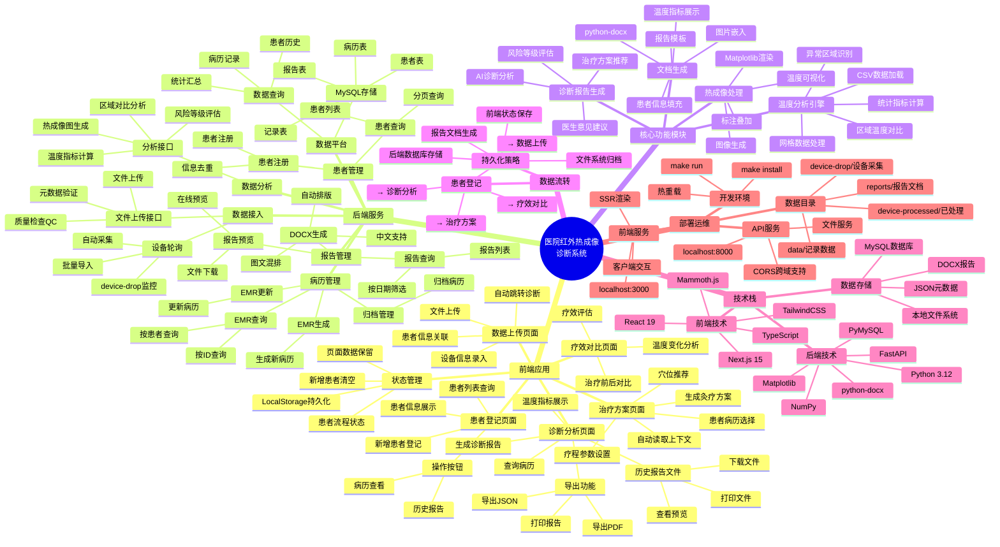

# 医院红外热成像诊断系统 - 项目思维导图



## 系统架构概览

### 1. 前端应用层
- **患者登记系统**：患者信息管理、去重、历史查询
- **数据采集流程**：上传设备数据、关联患者、自动分析
- **诊断分析中心**：报告生成、温度分析、风险评估
- **治疗方案管理**：基于诊断的智能治疗建议
- **疗效追踪对比**：治疗前后数据对比分析

### 2. 后端服务层
- **设备数据接入**：文件上传、设备轮询、批量导入
- **智能分析引擎**：温度计算、区域对比、风险评估
- **病历管理系统**：EMR生成、查询、更新、归档
- **报告生成服务**：DOCX文档、在线预览、打印下载

### 3. 数据存储层
- **MySQL数据库**：患者、记录、病历、报告
- **文件系统**：原始数据、热成像图、报告文档
- **状态持久化**：LocalStorage、JSON配置

### 4. 核心算法
- **温度分析**：统计计算、区域对比、异常检测
- **图像处理**：热力图生成、温度可视化
- **诊断推理**：风险分级、治疗建议

### 5. 业务流程
```
患者登记 → 数据上传 → 诊断分析 → 生成报告 → 治疗方案 → 疗效评估
   ↓         ↓          ↓          ↓         ↓         ↓
 数据库    文件存储   分析引擎   报告文档   穴位推荐   对比分析
```

### 6. 特色功能
- **状态保持**：跨页面数据保留，仅新增患者时清空
- **智能预填**：诊断分析后自动带入治疗方案
- **多格式导出**：JSON、PDF、DOCX、打印预览
- **历史追溯**：患者报告文件管理、在线查看
- **去重机制**：姓名+性别+年龄签名避免重复

## 技术亮点

1. **全栈TypeScript**：类型安全、开发效率高
2. **微服务架构**：前后端分离、独立部署
3. **智能分析**：温度网格处理、区域异常检测
4. **文档自动化**：基于模板的报告批量生成
5. **用户体验**：状态持久化、无感数据恢复
6. **中医特色**：艾灸穴位推荐、疗程方案定制
